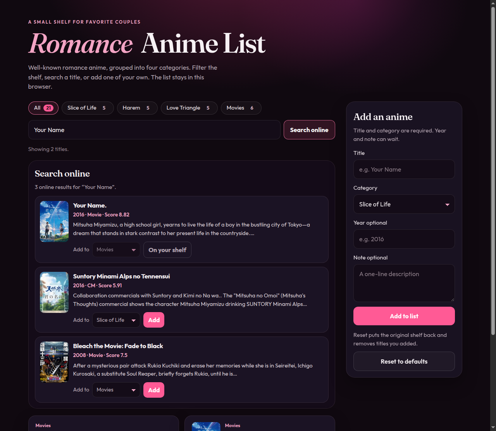

# Romance Anime List

A small shelf for favorite couples: twenty well-known romance anime, grouped into Slice of Life, Harem, Love Triangle, and Movies. Filter the shelf, search a title, look one up online, or add one of your own. The list stays in this browser.

## How to run

Open `index.html` in a browser. There is no install and no build step. The page is static: the same files can be published as a static site, and the browser talks to the anime search directly. No server code is required.

## Features

- Twenty real romance anime, five in each category, with a year and a one-line note
- Filter buttons for All, Slice of Life, Harem, Love Triangle, and Movies, each with a live count
- Search across title, year, and note on the saved shelf
- Search online for a title on MyAnimeList. The page calls the Jikan API v4 (`https://api.jikan.moe/v4/anime?q=<query>&limit=10&sfw=true`), which needs no key. That public host stopped answering in October 2026, so if it does not respond the same query is sent to [Tenrai](https://tenrai.org/), a free Jikan-compatible API (`https://api.tenrai.org/v1/anime`) with the same result shape
- Online results show a poster, title, year, score, type (such as TV or Movie), and a short synopsis, with loading, empty, error, and rate-limit (HTTP 429) messages
- Add an online result with the category picker (Slice of Life, Harem, Love Triangle, or Movies). The poster URL is saved with the card, and the card shows the poster
- Add a title by hand with a required category and an optional year and note
- Delete any card
- The shelf is saved in `localStorage`, so a refresh keeps your changes
- Reset to defaults restores the original twenty titles

## What Cursor helped create

Cursor helped me create a beginner-friendly romance anime shelf in plain HTML, CSS, and JavaScript, with real titles sorted into Slice of Life, Harem, Love Triangle, and Movies, plus category counts and cards that stay readable on a phone or a wide window. It also wired up search, adding, deleting, and browser saving, so the list I build is still there after a refresh.
